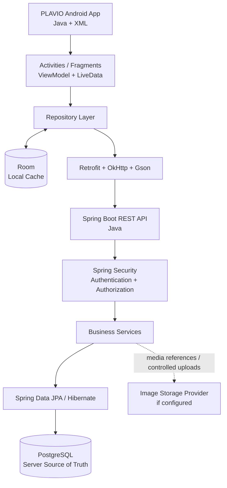
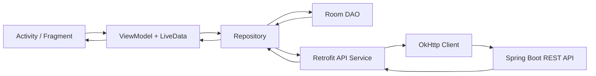
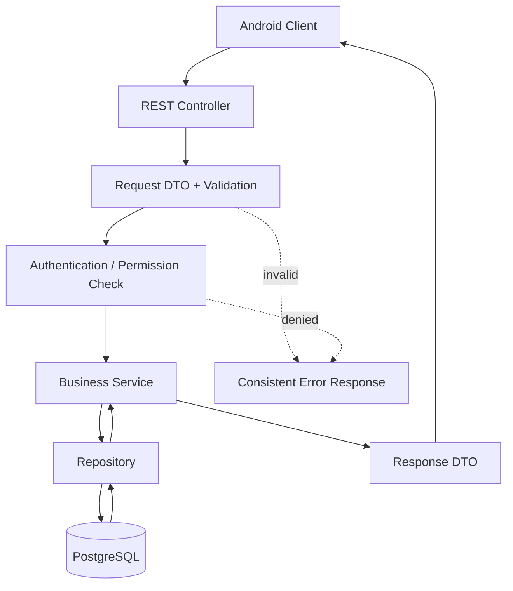
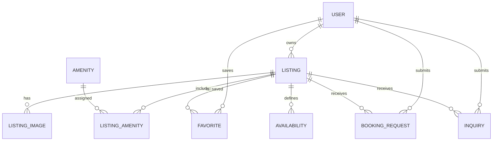

# PLAVIO


[](https://developer.android.com/) [](https://www.java.com/) [](https://m3.material.io/) [](https://github.com/square/retrofit) [](https://github.com/square/okhttp) [](https://github.com/bumptech/glide) [](https://developer.android.com/training/data-storage/room) [](https://spring.io/projects/spring-boot) [](https://spring.io/projects/spring-security) [](https://spring.io/projects/spring-data-jpa) [](https://www.postgresql.org/) [](https://maven.apache.org/) [](https://gradle.org/) [](https://git-scm.com/) [](https://github.com/Melikash98/PLAVIO)


**Property discovery and booking-request application**  
*Native Android · Java · Spring Boot REST API · PostgreSQL · Room*

PLAVIO is a mobile-first property application designed to help users discover listings, review property information, save places they may be interested in, and submit the appropriate property-related request from an Android app.

The application is built around two connected parts: a native Android client and a Java/Spring Boot backend. PostgreSQL is the authoritative database for shared application data, while Room supports selected local data and cache needs on the device.

> **Project scope:** Android application, its app-related local persistence, the Spring Boot REST API used by the application, and the backend database. A separate web administration panel, payment processing, host payouts, and financial settlement are not included in this scope.

---

## Contents

- [Product Overview](#product-overview)
- [Product Goals](#product-goals)
- [Core User Flows](#core-user-flows)
- [Project Scope](#project-scope)
- [Architecture at a Glance](#architecture-at-a-glance)
- [Technology Stack](#technology-stack)
- [Android Application](#android-application)
- [Backend Architecture](#backend-architecture)
- [Data Model](#data-model)
- [Local Data and Synchronization](#local-data-and-synchronization)
- [REST API Design](#rest-api-design)
- [Security and Privacy](#security-and-privacy)
- [Error Handling](#error-handling)
- [Testing and Quality](#testing-and-quality)
- [Suggested Repository Layout](#suggested-repository-layout)
- [Team Workflow](#team-workflow)
- [Local Development Setup](#local-development-setup)
- [Configuration and Secrets](#configuration-and-secrets)
- [Delivery Roadmap](#delivery-roadmap)
- [Definition of Done](#definition-of-done)
- [Scope Boundaries](#scope-boundaries)

---

## Product Overview

Looking for a property often means searching across multiple listings, comparing details, and keeping track of promising options. PLAVIO brings these activities into a focused mobile experience, prioritizing clear property information, convenient discovery, and predictable request flows.

The product is organized around three primary user needs:

1. **Discover:** Browse property listings, search using supported criteria, apply filters, and review listing details.
2. **Save:** Keep selected listings available for later review through a favorites feature.
3. **Request:** Submit a booking request for an eligible short-stay listing or an inquiry for a rental, sale, or viewing opportunity, depending on the listing type.

Short-stay booking requests and rental/sale inquiries are separate business flows. They can share account and property data, but they must not share the same validation rules or status transitions by default.

## Product Goals

- Deliver a clear, consistent, and accessible Android experience for property discovery.
- Keep UI presentation, application logic, network access, and local persistence separated.
- Provide a versioned REST API that the Android application can access through Retrofit.
- Use PostgreSQL as the source of truth for shared records and business transactions.
- Use Room only for selected cache and local-access needs; it is not the authority for shared booking or listing status.
- Make the codebase maintainable for a team through documented API contracts, database migrations, tests, code reviews, and a predictable Git workflow.

## Core User Flows

### 1. Discover a property

1. The user opens the Android application.
2. The app displays available listings and supported discovery content.
3. The user searches by supported criteria such as location, property type, price range, or capacity.
4. The user opens a listing to review its description, photos, amenities, pricing information, and relevant conditions.
5. The user can save the listing or continue to the appropriate request flow.

### 2. Save a favorite

1. The user selects the favorite action on a listing.
2. The app sends the change to the backend when authenticated and online.
3. The backend verifies the user's identity and prevents duplicate user/listing relationships.
4. The app updates the visible state based on the authoritative result. Local cache may be updated to keep the UI responsive.

### 3. Submit a booking request or inquiry

1. The user chooses the applicable action for a listing.
2. The app collects the required information and performs basic input validation.
3. The backend validates the user's permissions, listing status, required fields, dates/capacity where applicable, and relevant business rules.
4. The backend persists the request and returns an identifier and current status.
5. The app displays the returned result and allows the user to review the request status where supported.

A submitted request is not automatically a confirmed booking. The UI must use the status returned by the server and must not imply confirmation unless the implemented business process explicitly confirms it.

### 4. Manage a host-owned listing

Where host listing management is provided through the mobile application, an authenticated owner can create or edit their own listing and manage its submitted information. The backend must verify ownership on every protected operation; hiding a button in the UI is not an authorization mechanism.

---

## Project Scope

### Included in this project

- Native Android application using Java and XML layouts.
- Property listing discovery and detail presentation.
- Search and filtering supported by the application.
- Account-related flows connected to the backend authentication API, where implemented.
- Favorites/saved listings.
- Booking-request and/or property-inquiry flows appropriate to the supported listing types.
- Host listing operations included in the Android client.
- Java/Spring Boot REST API consumed by the Android application.
- PostgreSQL persistence for shared application records.
- Room persistence for selected local cache or offline-read data.
- Input validation, access control, error handling, automated tests, and technical documentation.

### Not included in this project scope

- A separate web-based administration panel or admin dashboard.
- Payment gateway integration, escrow, host payouts, or financial settlement.
- A standalone reporting/analytics portal.
- Microservices or Kubernetes infrastructure without a demonstrated need.
- External services that are not configured and included in the delivered implementation.

---

## Architecture at a Glance



### Architecture principles

- **Android client:** Use MVVM with ViewModel and LiveData, backed by a Repository that coordinates local and remote data access.
- **Networking:** Keep Retrofit service interfaces and API request/response DTOs separate from UI code.
- **Backend:** Start with a **modular monolith**—one Spring Boot service with clear module boundaries—rather than splitting the first release into microservices.
- **Database ownership:** The backend owns validation and writes for shared records. PostgreSQL is the source of truth.
- **Local persistence:** Room supports selected cached data. It must not independently decide shared business outcomes such as a confirmed booking.
- **API versioning:** Use a prefix such as `/api/v1` and publish a stable contract with OpenAPI.
- **Image storage:** Store photo files in an object/media storage provider if configured. Store references and metadata in PostgreSQL, rather than the binary image content itself.

## Technology Stack

| Area | Selected technology | Responsibility |
|---|---|---|
| Android language | Java | Client-side logic |
| Android UI | XML layouts + Material Components | Native UI and reusable visual components |
| Android architecture | MVVM, ViewModel, LiveData, Repository | Separation of UI, state, and data responsibilities |
| API client | Retrofit + OkHttp + Gson converter | HTTP requests and JSON serialization |
| Local database | Room | Selected cache/offline reads on the device |
| Image loading | Glide | Efficient image loading in Android, where used |
| Backend language | Java 21 LTS | Server-side application logic |
| Backend framework | Spring Boot 4.x | Backend service and application configuration |
| Web/API layer | Spring Web / MVC | Versioned REST endpoints |
| Authentication and authorization | Spring Security with token-based authentication | Protect API operations and user data |
| ORM/persistence | Spring Data JPA + Hibernate | Relational mapping and repository access |
| Server database | PostgreSQL 18.x | Durable shared application data |
| Schema migrations | Flyway | Version-controlled schema evolution |
| API documentation | Springdoc OpenAPI / Swagger UI | API reference and developer verification |
| Backend build | Maven | Dependency and build lifecycle management |
| Android build | Gradle | Android dependency management and build |
| Backend tests | JUnit 5, Mockito, Spring Boot Test, MockMvc | Unit and API/security testing |
| Database integration tests | Testcontainers, where supported by CI | Tests against PostgreSQL in a controlled environment |
| Source control | Git + GitHub | Collaboration, review, and change history |
| Continuous integration | GitHub Actions | Automated build and test checks |
| Media storage | Cloudinary or compatible object storage, if configured | Listing image delivery and storage |

Pin exact dependency versions in the Gradle and Maven build files. Before implementation or upgrades, verify compatibility among the JDK, Spring Boot release, and libraries actually selected for the repository.

---

## Android Application

### Recommended responsibility boundaries



- **Presentation:** Activities/Fragments, XML layouts, navigation, UI state, loading and error states.
- **ViewModel:** Holds screen state and coordinates user actions without storing Activity/Fragment references.
- **Repository:** Provides a single access point for remote and local data.
- **Remote data source:** Retrofit interfaces and DTOs used to communicate with the REST API.
- **Local data source:** Room entities, DAOs, and database configuration for cacheable data.
- **Image loading:** Glide can be used for listing photos and thumbnails where included in the application.

### UI states

Screens that load server data should account for loading, success, empty results, recoverable errors, and retry behavior. Search filters and form validation should provide clear feedback without relying only on network error messages.

## Backend Architecture

PLAVIO's backend uses a modular-monolith structure. Each module groups related business rules and should keep HTTP controllers thin. Controllers validate request shape, services apply business rules, repositories manage persistence, and DTOs define the external API contract.

### Suggested backend modules

| Module | Responsibility |
|---|---|
| `auth` | Registration, login, token handling, and authentication support |
| `user` | User profile and account data required by the app |
| `listing` | Listing lifecycle, owner association, listing details, and publication state |
| `search` | Search parameters, supported filters, sorting, and pagination |
| `favorite` | Saving and removing favorites |
| `booking` | Short-stay booking requests and relevant validations |
| `inquiry` | Rental, sale, contact, and viewing inquiries |
| `media` | Image metadata and controlled integration with media storage |
| `notification` | User-facing notification records when included |
| `common` | Shared API errors, validation, configuration, and utility code |

### Suggested backend request flow



Keep business rules out of controllers. Do not expose JPA entities directly from REST endpoints. Use request and response DTOs and explicit validation. Use transactions for operations that must be atomic, particularly those involving favorites, listing updates, and date-sensitive booking requests.

---

## Data Model

PostgreSQL is the authoritative database for shared records. The model below is an initial domain design; actual table names and columns should match the database migrations and entities in the codebase.



### Domain concepts

| Entity | Responsibility |
|---|---|
| `users` | Account identifier and profile fields required by the application |
| `listings` | Property type, description, location, price metadata, owner, and listing status |
| `listing_images` | Image references, sort order, and optional captions |
| `amenities` | Reusable property features, if amenities are part of the app |
| `listing_amenities` | Many-to-many association between listings and amenities |
| `favorites` | User-to-listing saved relationship |
| `booking_requests` | Short-stay booking requests, requested dates, guest count, and status where applicable |
| `inquiries` | Contact, rental, sale, or viewing requests |
| `availability` | Availability intervals where required by the booking rules |

### Data integrity rules

- Use stable primary keys and explicit foreign keys.
- Add a unique constraint to prevent duplicate `(user_id, listing_id)` favorite relationships.
- Represent money with a decimal type and an explicit currency; do not use floating-point types for stored prices.
- Store timestamps consistently on the backend, preferably as UTC instants. Interpret stay dates with an explicit property timezone where needed.
- Keep listing, booking-request, and inquiry statuses separate, with defined allowed transitions.
- Add indexes based on actual query patterns and query-plan analysis rather than indexing every field by default.
- Use Flyway migration scripts to create and evolve the schema in a reproducible way.

## Local Data and Synchronization

### PostgreSQL — server source of truth

The backend owns the canonical version of user accounts, listing details, favorites, inquiries, and booking-request status. The server validates and persists shared changes so that different devices cannot independently decide the same business outcome.

### Room — Android-local persistence

Room is intended for selected data that benefits from local availability, such as recently loaded listing summaries and details. Use it to improve perceived responsiveness and, where designed, support limited offline browsing.

- **Read flow:** Display valid cached content when useful, request the latest API response, update the local cache on success, and refresh the UI.
- **Write flow:** Submit changes that affect shared business records to the API and reconcile local state from the server response.
- **Conflict handling:** Treat the server response as authoritative for listing status, favorite state, and booking/inquiry status.
- **Offline boundary:** Cached browsing may be available offline. A booking request must not be shown as submitted or confirmed unless the backend accepts it.
- **Sensitive data:** Do not store passwords, signing secrets, or unnecessary personal information in Room. Protect locally stored session material using an appropriate secure-storage approach.

### Images

Store image files in a media/object-storage service if that provider is part of the delivered setup. Store image URLs/references and metadata in PostgreSQL. Do not embed storage credentials or privileged upload secrets in the Android application.

---

## REST API Design

The Android app accesses the backend through a versioned JSON REST API. The endpoint list below is the proposed contract surface; request and response fields should be finalized in OpenAPI and checked against the actual implementation.

| Method | Endpoint | Purpose |
|---|---|---|
| `POST` | `/api/v1/auth/register` | Register an account |
| `POST` | `/api/v1/auth/login` | Authenticate a user |
| `GET` | `/api/v1/users/me` | Retrieve the current user's profile |
| `PATCH` | `/api/v1/users/me` | Update supported profile fields |
| `GET` | `/api/v1/listings` | Search and paginate listings visible to users |
| `GET` | `/api/v1/listings/{listingId}` | Retrieve listing details |
| `POST` | `/api/v1/listings` | Create an owned listing when host creation is part of the app scope |
| `PATCH` | `/api/v1/listings/{listingId}` | Update an owned listing |
| `DELETE` | `/api/v1/listings/{listingId}` | Deactivate or delete an owned listing according to policy |
| `GET` | `/api/v1/favorites` | List the user's favorites |
| `PUT` | `/api/v1/favorites/{listingId}` | Save a listing; operation should be idempotent where possible |
| `DELETE` | `/api/v1/favorites/{listingId}` | Remove a favorite |
| `POST` | `/api/v1/booking-requests` | Submit a short-stay booking request |
| `GET` | `/api/v1/booking-requests` | Retrieve the current user's booking requests |
| `POST` | `/api/v1/inquiries` | Submit a rental, sale, contact, or viewing inquiry |

### API conventions

- Prefix endpoints with `/api/v1`.
- Use DTOs instead of exposing persistence entities.
- Validate request input at the API boundary and apply domain rules in services.
- Require authentication for user-specific and write operations.
- Enforce ownership on the server for resources that belong to a user.
- Add pagination and stable sorting to collection/search endpoints.
- Return a consistent error schema with a machine-readable error code, a safe message, and optional field-level validation details.
- Document endpoints, DTOs, authentication requirements, and sample responses in OpenAPI.

### Booking and inquiry integrity

- A short-stay request validates date order, capacity, listing status, and availability on the server.
- Concurrent overlapping date requests require transaction-safe checking and an appropriate database constraint or locking strategy.
- A rental/sale inquiry is a separate workflow and must not be represented as a confirmed reservation.
- The backend calculates authoritative price details wherever applicable; the client must not be trusted to submit the final price.
- Payment processing and financial settlement are outside the current project scope.

---

## Security and Privacy

- Enforce HTTPS outside local development.
- Validate all input on the server, even where the Android app also validates it.
- Use Spring Security to protect endpoints and verify permissions; enforce resource ownership in backend logic.
- Store passwords only as strong one-way hashes through a suitable password encoder.
- If JWT is used, define token expiry and a secure refresh/revocation strategy; never commit signing keys.
- Keep database passwords, API keys, signing keys, service-account files, and production configuration outside the repository.
- Use least-privilege database and service credentials.
- Validate media upload authorization, file type, and size on the server.
- Avoid placing passwords, tokens, or unnecessary personal data in logs and error responses.
- Apply rate limiting and abuse controls to authentication and request-submission endpoints where appropriate.

A separate administration interface is not part of this repository scope. Administrative web workflows must not be implied by this documentation.

## Error Handling

A predictable API error contract helps the Android app show useful messages without exposing internals. Use HTTP status codes consistently:

| Status | Typical meaning |
|---|---|
| `200 OK` | Request succeeded |
| `201 Created` | A resource was created |
| `204 No Content` | Operation succeeded with no response body |
| `400 Bad Request` | Request is invalid |
| `401 Unauthorized` | Authentication is missing or invalid |
| `403 Forbidden` | Authenticated caller lacks permission |
| `404 Not Found` | Resource does not exist or is not available to the caller according to policy |
| `409 Conflict` | Request conflicts with current state, such as availability or a duplicate operation |
| `500 Internal Server Error` | Unexpected server error; do not expose a stack trace to the client |

The precise status code and error payload should be confirmed in the OpenAPI contract and tests.

---

## Testing and Quality

### Android

- Unit-test ViewModels and repository state transitions.
- Test API response mapping and error handling.
- Add UI/instrumentation tests for navigation and the most important user flows.
- Check empty, loading, success, and error states.
- Verify behavior on different screen sizes and network conditions.

### Backend

- Use JUnit 5 and Mockito for business-rule tests.
- Use Spring Boot Test and MockMvc for controller, validation, and security behavior.
- Test repository queries and transaction-sensitive operations against PostgreSQL.
- Use Testcontainers for database integration tests where supported in CI.
- Cover invalid input, unauthenticated access, ownership violations, duplicate favorites, and conflicting availability.

### Quality gate

A change is ready to merge only when the build succeeds, relevant tests pass, API and database changes are documented, and a reviewer has approved the pull request.

---

## Suggested Repository Layout

Use the real directory structure as the source of truth. The following is a target layout for a repository that contains both Android and backend code; only add directories when the relevant implementation exists.

```text
PLAVIO/
├── android-app/                 # Native Android app (Java/XML)
│   └── app/
│       └── src/
│           ├── main/
│           │   ├── java/         # Screens, ViewModels, repositories, API/data models
│           │   └── res/          # Layouts, drawables, strings, themes
│           ├── test/             # Local JVM tests
│           └── androidTest/      # Instrumentation/UI tests
├── backend/                     # Java + Spring Boot REST API
│   └── src/
│       ├── main/
│       │   ├── java/             # Modules, controllers, services, repositories
│       │   └── resources/        # Configuration templates and Flyway migrations
│       └── test/                 # Unit and integration tests
├── .github/
│   └── workflows/                # CI workflows, when configured
├── .gitignore
├── CONTRIBUTING.md
├── CODE_OF_CONDUCT.md
└── README.md
```

The exact Android module name and backend folder name can differ. Avoid documenting commands or file paths until they match the checked-in repository.

## Team Workflow

1. Track work with GitHub Issues and define clear acceptance criteria for each task.
2. Use short-lived branches such as `feature/listing-search` or `fix/favorite-sync`.
3. Open pull requests with a concise summary, test evidence, relevant screenshots, and notes about API or database changes.
4. Run Android and backend builds/tests through CI when workflows are configured.
5. Review code before merging into the default branch.
6. Evolve the database through Flyway migrations instead of undocumented manual changes.
7. Coordinate API changes between Android and backend developers through the OpenAPI contract.
8. Keep secrets and real customer information out of issues, test fixtures, screenshots, and commits.

## Local Development Setup

The final commands depend on the actual repository layout and checked-in build files. A standard development setup should include:

1. Install a compatible JDK, Android Studio, Android SDK, and PostgreSQL. Docker may be used if the project provides a Compose configuration.
2. Clone the repository and open the Android module in Android Studio.
3. Configure local backend settings using safe local environment variables or an ignored local configuration file.
4. Start PostgreSQL and apply the project's Flyway migrations through the backend startup process.
5. Run the Spring Boot service with the Maven wrapper once it exists in the repository.
6. Configure the Android API base URL for the target device/emulator. Android Emulator commonly reaches a host-machine local service through `10.0.2.2`; a physical device needs a reachable host address and appropriate network configuration.
7. Build and run the Android application.
8. Run the Android and backend test suites before opening a pull request.

Add exact commands only after confirming the project contains the corresponding Gradle/Maven wrapper files and environment configuration.

## Configuration and Secrets

Externalize environment-specific values such as:

- PostgreSQL connection URL, username, and password.
- Token-signing configuration, if token authentication is used.
- Media-service credentials, if a media provider is configured.
- External-service keys introduced by the implementation.

Provide safe placeholders in a file such as `.env.example` or `application-local.example.yml`. Keep real local configuration excluded through `.gitignore`. Never commit production credentials, private keys, service-account JSON, or personal data.

---

## Delivery Roadmap

### Phase 1 — Product and API alignment

- Confirm the MVP listing types and supported user flows.
- Finalize screen navigation and loading/error/empty states.
- Agree the PostgreSQL domain model and migration baseline.
- Publish the initial OpenAPI contract for Android/backend collaboration.

### Phase 2 — Foundation

- Establish backend modules and database connectivity.
- Implement account/authentication workflows required by the mobile app.
- Establish Retrofit networking, common response/error handling, and Room setup.

### Phase 3 — Core property experience

- Implement listing retrieval, details, and supported search/filter behavior.
- Add image rendering and local caching rules.
- Add favorites and user-specific data access.

### Phase 4 — Property requests

- Implement the booking-request workflow for eligible short-stay listings, if included.
- Implement separate inquiries for rental, sale, or viewing workflows.
- Add ownership checks, validation, status handling, and relevant transaction tests.

### Phase 5 — Quality and delivery

- Add automated tests and CI checks.
- Verify setup instructions and safe configuration templates.
- Run acceptance tests for the key mobile and API flows.
- Prepare a release candidate and a concise change log.

---

## Definition of Done

A feature is considered complete when:

- Its behavior and acceptance criteria are documented.
- The UI includes appropriate loading, empty, success, and error states where relevant.
- API requests and responses match the documented contract.
- Authorization, input validation, and ownership rules are enforced server-side.
- Database changes are represented by reviewed migrations.
- Relevant automated tests pass.
- The change has been reviewed and merged through the team workflow.
- No secrets or real user data are included in the commit.
- Documentation reflects the actual behavior and setup of the code.

## Scope Boundaries

PLAVIO's defined scope is the Android application, its associated local data handling, the Java/Spring Boot REST API, and the server-side database. A separate administration panel, payment gateway, payout system, and web dashboard are explicitly outside this scope.

The feature list, technology versions, API contracts, and setup instructions in this README must remain consistent with the code and configuration committed to the repository. Do not present a proposed endpoint, third-party integration, test suite, or workflow as delivered unless it is present and verified in the project.

---

**PLAVIO — discover properties, compare options, and manage property-related requests in one mobile experience.**
